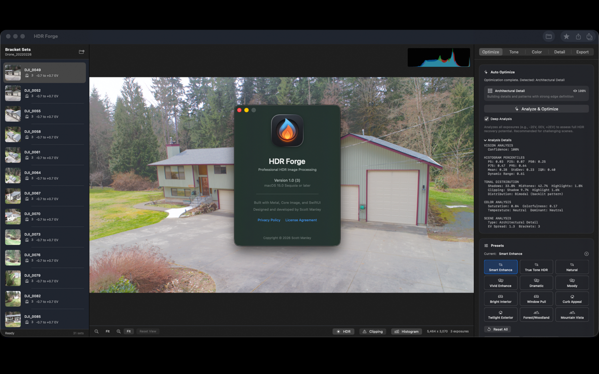
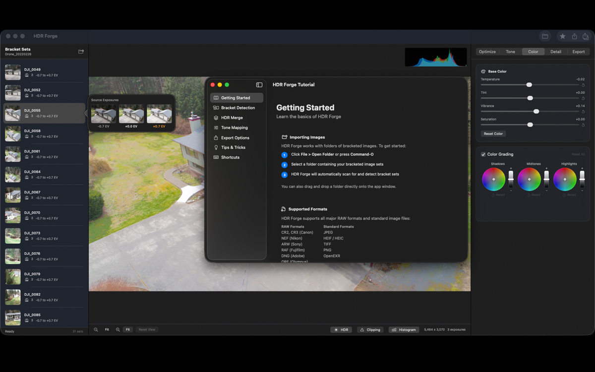

# HDR Forge

HDR processing for Mac.

HDR Forge merges auto exposure bracketing (AEB) sets into HDR images on your Mac, with batch processing for large shoots. Free to download.

- Website: https://hdrforgeapp.com
- Mac App Store: https://apps.apple.com/us/app/hdr-forge/id6758351669
- Support: https://github.com/workmanl/HDR-Forge/issues
- Email: hello@emrldlabs.com

## About this repository

The app's source code is not public. This repository is used for support: please open an issue for bug reports and questions.
